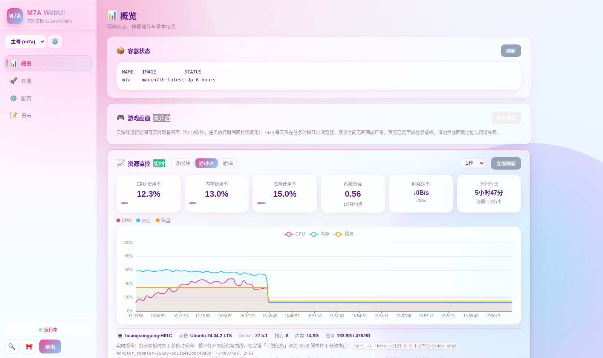
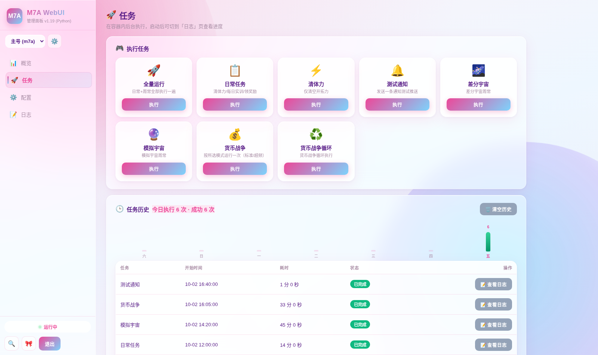
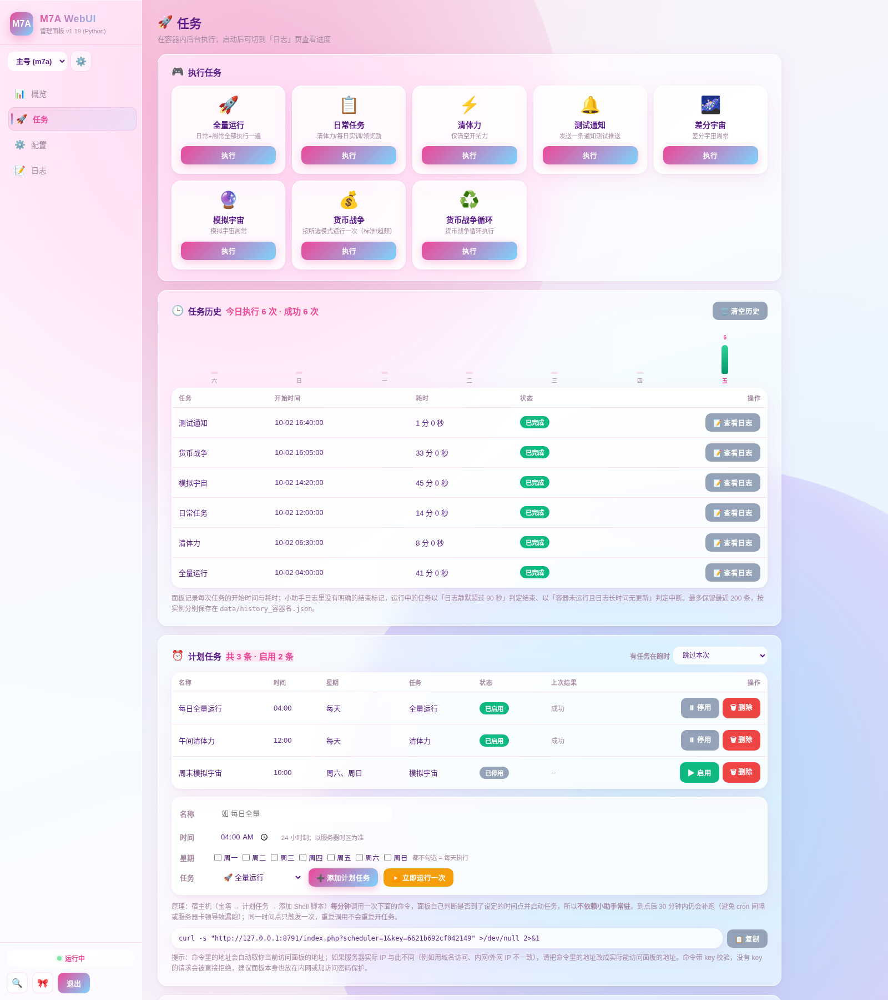
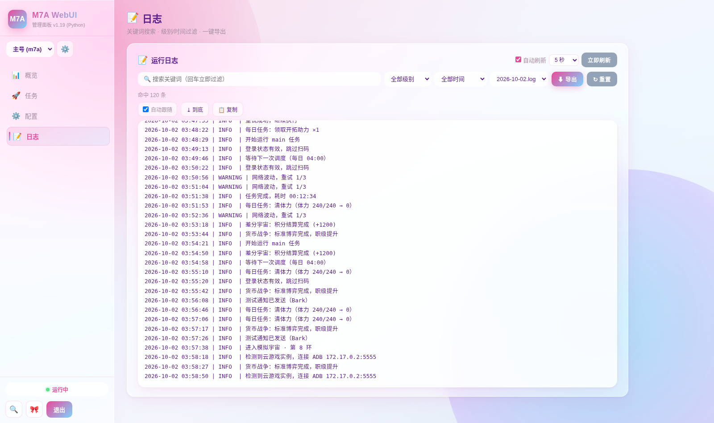
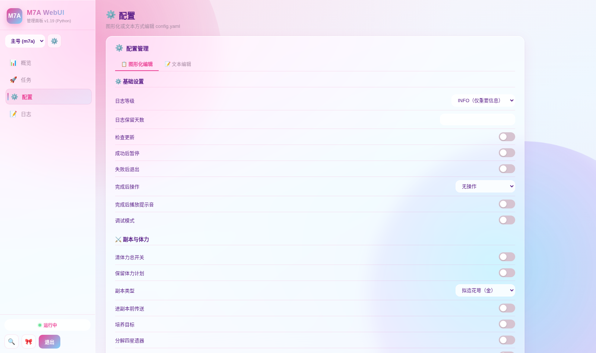
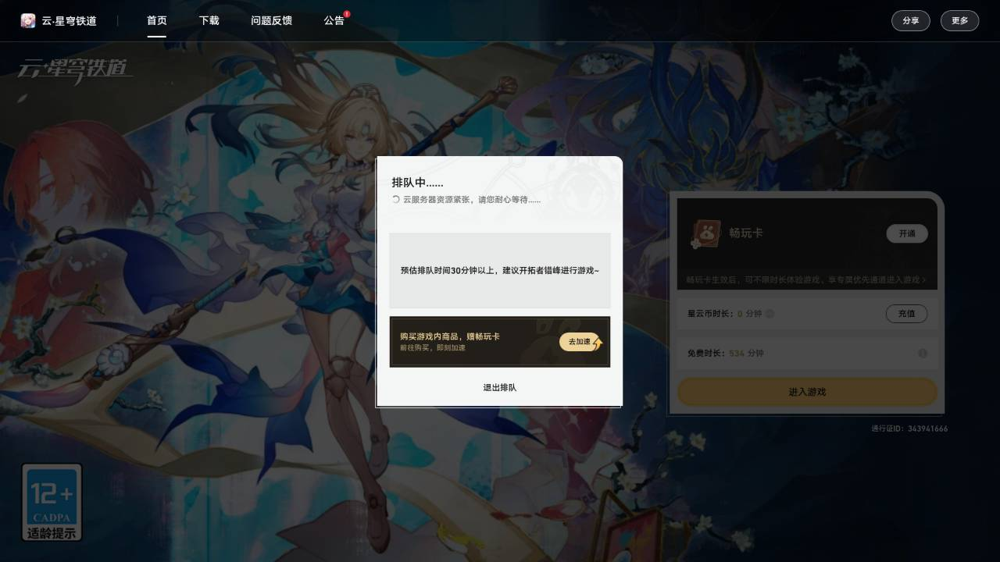

# March7th 小助手网页管理面板（Python 重制版）

> 浏览器里管三月七小助手，告别 SSH 命令行。


---

## 📖 目录

| 想做什么 | 去哪看 |
|---|---|
| 先看看它能干什么 | [核心特性](#-核心特性) · [界面预览](#-界面预览) |
| 最近更新了什么 | [近期版本亮点](#-近期版本亮点) |
| 直接装起来用 | [快速开始](#-快速开始) |
| 装了但不会用 | [使用指南](#-使用指南) |
| 想改配置 / 调参数 | [配置项速查](#-配置项速查) |
| 出问题了 | [常见问题](#-常见问题) · [故障排查](#-故障排查) |

---

## 这是什么

> ⚠️ **本面板为第三方开发的配套管理工具，非官方出品，与米哈游（HoYoverse）无关。**

本面板是 [三月七小助手（March7thAssistant）](https://github.com/moesnow/March7thAssistant) 的配套网页管理工具。原项目跑在电脑上的 GUI / 命令行程序，人不在电脑前就没法操作；把小助手部署到服务器后，你用手机或电脑浏览器就能随时远程管理——启动日常任务、清体力、改配置、看日志、盯监控，全程不需要命令行。

**技术栈**：Python 3.11+ / FastAPI / Uvicorn 全栈驱动，systemd 常驻、崩溃自动重启，不依赖 fastcgi 等传统链路。实时数据通过 **WebSocket 事件流**推送，监控按秒级采样刷新（cgroup 直读、零子进程，开销极低）；游戏画面预览采用 **CDP 帧流反代 + 按日 HMAC 令牌**，支持 720P/480P 切档、H.264 15/30 帧可选与断线重连。

| 你的情况 | 该怎么做 |
|---|---|
| ✅ 已经用 Docker 跑着小助手 | 直接部署面板，[方式二](#方式二生产环境部署systemd) 即可 |
| 🆕 还没部署小助手 | 先看 [方式三](#方式三从零部署小助手本体可选) 从零搞定（约 20 分钟） |

**几个关键事实**

- 纯 Python 依赖、文件存储（JSON + SQLite 事件库），**无需数据库**，开箱即用
- 界面与操作习惯保持延续：登录态、面板配置、实例列表、密码文件全部直接复用，**升级无需迁移数据**
- `routers` / `services` 清晰分层，582 项 pytest 用例兜底，方便二次开发
- 手机、电脑浏览器均可使用

---

## ✨ 核心特性

### 🚀 任务与容器管理

| 能力 | 说明 |
|---|---|
| **多实例切换** | 侧边栏下拉一键切换多个小助手实例（多账号 / 多容器），每个实例独立管理任务、配置、日志 |
| **一键执行任务** | 全量运行 / 日常任务 / 清体力 / 测试通知 / 差分宇宙 / 模拟宇宙 / 货币战争 / 货币战争循环 |
| **链式启动** | 点快捷操作若小助手未运行会自动拉起并接着执行任务，不用先手动启动容器 |
| **随时可控** | 概览页常驻「⏹️ 停止任务」「⏸️ 停止小助手」；运行中任务悬浮条实时显示任务名与已运行时长 |
| **底部中央快捷键** | 中央圆钮点一下弹出任务清单想跑哪个点哪个，长按弹容器操作菜单（重启 / 停止 / 更新镜像） |
| **容器操作四按钮** | 重启容器、停止任务（重启容器）、停止循环（轻量，仅停货币战争循环）、停止容器（`docker compose stop`，不删数据） |
| **任务结束后设置** | 一键切换「跑完自动退出游戏 / 跑完保持界面」 |

> 💡 三个「停止」的区别：`⏹️ 停止任务` = 重启容器（任务进程就是容器 PID 1，忽略 SIGTERM，无法只停任务）；`🛑 停止循环` = `pkill -15` 精准结束货币战争循环子进程，容器与主进程完全不动；`⏸️ 停止容器` = `docker compose stop` 彻底停掉，容器镜像数据都不删。

### 📊 监控与数据

| 能力 | 说明 |
|---|---|
| **资源监控仪表盘** | CPU / 内存 / 磁盘 / 负载 / 网络速率 / 运行时长六指标实时跳动 + 三条曲线（1 分钟 / 1 小时 / 1 天 / 7 天 / 30 天）+ 自定义时段查询；短区间细粒度、长区间自动聚合，图表与导出口径完全一致 |
| **零开销采样** | cgroup / Docker Engine API 直读，不再每次拉起 `docker stats`；面板不开曲线也不断——卡片内一键复制带 key 的采样命令挂到宿主 cron |
| **任务执行历史** | 自动记录每次任务的开始时间、耗时与结果，顶部显示「今日执行 N 次 · 成功 X 次」；运行中 / 已完成 / 已中断三色徽章，按实例保存、保留最近 200 条 |
| **任务成功率统计** | 近 30 天按任务分别统计执行次数、成功/中断次数、成功率与平均耗时，低于 90% / 60% 分级标色 |
| **任务收益日报** | 任务结束后自动从本体日志读出这一趟的收获（开拓力剩余、副本挑战次数、每日实训得分、完成的玩法与奖励），按天归档，支持近 7 / 14 / 30 天切换与柱状图 |
| **数据一键导出** | 任务历史（近 90 天）/ 告警事件（近 30 天）/ 监控归档（近 7 天）导出 CSV（带 BOM，Excel 不乱码），也支持 `format=json` |

### 🔔 告警与通知

| 能力 | 说明 |
|---|---|
| **分级可控告警** | Bark / Server 酱 / Webhook 等通道，容器掉线、任务被中断、久无输出第一时间推到手机；分「提示 / 警告 / 严重」三级，三级可各配一条通道、也可按级别单独静音 |
| **推送可靠性** | 失败按 30/60/120 秒自动重试（最多 3 次），连续失败进入 5 分钟冷静期，同类型告警 2 分钟内不重复推送 |
| **首次启动失败也告警** | 容器从第一次巡检就没起来（从未运行过）同样算掉线边沿，不会因为「上一轮状态未知」而永久不报警 |
| **静默期不丢事件** | 点「重启」自动静默 10 分钟；静默期内检测到的掉线/中断会记录下来，静默结束后补发，且同一类型一轮只推一次 |
| **可视化告警时间轴** | 按日期分组展示，容器停止/恢复/任务中断用不同颜色，每条标注推送状态；支持按类型与时间筛选、一键清空、新告警实时插入 |
| **磁盘空间预警** | 每 6 分钟探一次（系统盘 + 数据盘），剩余低于 15% 推警告、低于 8% 推严重，恢复后自动发「已恢复」；阈值可调，支持「立即检查」 |
| **每日健康晨报** | 默认 08:00 推一条纯文本晨报：昨日任务完成/中断数、昨日告警条数、磁盘剩余、本体是否存活、本体版本有无更新；时间可改、可关闭、支持立即发送预览，漏了 4 小时内补发 |
| **本体更新提醒** | 每 6 小时比对 March7thAssistant 官方 Release 与服务器上真实版本，有新版推警告级提醒并在标题旁挂角标（仅提醒、不自动升级） |

### 🎮 游戏画面实时预览

| 能力 | 说明 |
|---|---|
| **浏览器直连** | 不用远程桌面、不用投屏，概览页一键开启实时观看云游戏画面，挂机、排队、战斗进度一眼可见 |
| **两档画质** | `720P / 480P` 随时切换，支持全屏 |
| **两种编码** | JPEG 逐帧（约 15 帧/秒，CPU 占用极低）或 ⚡H.264 极致档（MSE，15 / 30 帧可选） |
| **编码器自适应** 🆕 | 自动探测 ffmpeg 实际编入的 H.264 编码器并按优先级选择：`libx264 → libopenh264 → h264_vaapi → h264_nvenc → h264_qsv → h264_v4l2m2m`，并自动带上对应硬件加速参数；一个都没有时明确告知「不支持 H.264 编码」而不是静默失败 |
| **按日令牌鉴权** | 令牌 = `HMAC-SHA256(密钥, 当天日期)` 截断 32 位，每天自动轮换，泄露的令牌过期即失效；面板与容器双端校验 |
| **断线自动重连** | 网络抖动按指数退避重连；切到后台标签页自动降频省流；多人同时点预览互不踢线 |
| **错误可见** 🆕 | ffmpeg 异常退出时以「不可用」状态码关闭并回传原因（不再伪装成正常关闭导致无限重连），同时边跑边排空错误管道，避免写满内核缓冲后转码卡死 |

### ⚙️ 配置编辑

| 能力 | 说明 |
|---|---|
| **图形化配置** | 覆盖日常、体力、模拟宇宙、活动、通知推送等 **168 个**常用配置项，19 个分组表单（开关 / 下拉 / 输入框），冷门分组可折叠 |
| **推送可视化配置** | 全部推送渠道集中图形化配置（Server 酱 / Bark / 钉钉 / 企业微信 / 飞书 / Telegram / PushPlus / Gotify / Discord / SMTP / Webhook / Matrix / PushDeer / KOOK / OneBot 等），每个字段写清填法 |
| **一键验证** | 「保存并发送测试推送」直接验证通道，「保存并体检」只读检查哪些渠道真正会发出去 |
| **高级文本编辑** | 完整 YAML 直接编辑（改队伍配置等复杂结构），上限 1 MB |
| **安全保存** 🆕 | 保存前自动备份 `config.yaml.bak.时间戳`；写入前做 YAML 结构校验（缩进、引号闭合、括号配平），校验不过**不写盘**；备份失败也直接中止；四条写路径统一原子替换 |
| **多行字段不再写坏** 🆕 | webhook 请求头/请求体、自定义图片/数据等多行输入框的值正确转义，反复保存也不会写出非法 YAML |

### 🎨 界面与体验

| 能力 | 说明 |
|---|---|
| **星铁粉蓝渐变主题** | 粉色→浅蓝渐变主视觉 + 玻璃拟态卡片；星铁粉蓝 / 亮色 / 深色三态循环切换 |
| **侧边栏布局** | 左侧固定导航（概览 / 任务 / 配置 / 日志），手机端自动变抽屉 + 底部胶囊悬浮导航 |
| **移动端适配** | 三档断点、触控目标 ≥44px、边缘左右滑切页、iPhone 底部安全区适配；支持「添加到主屏幕」（PWA）独立 App 体验 |
| **全局搜索** | 侧边栏与手机顶栏 🔍，输关键词直达任务、页面、配置项与常用操作 |
| **日志高级查询** | 关键词搜索高亮、级别/时间过滤、多日志文件切换、一键导出、命中计数、自动跟随/到底/复制工具条 |
| **细节打磨** | 回到顶部、通知自动淡出、动效与性能降级（低配机自动去磨砂换实底） |

### 🛡️ 安全与可靠性

| 能力 | 说明 |
|---|---|
| **密码保护** | 首次访问设置密码，bcrypt 哈希存储于 `.panel_pass.php`；登录限速 + 会话轮换 |
| **CSRF 防护** | 全部写操作强制校验，要求「会话里有 csrf 值 + 提交值非空 + 常量时间比对一致」，空 token 无法绕过 |
| **登录限速** 🆕 | 单 IP 5 次/5 分钟锁定；失败来源从可信头（`X-Real-IP` / XFF 末段）取，伪造头换 IP 无效；**任一来源成功登录即整体清零**，第三方爆破不会拖累管理员 |
| **会话安全** 🆕 | 会话文件读改写全程加锁 + 跨进程 `lockf`，拒绝符号链接写入（`O_NOFOLLOW`），默认落在面板私有目录、权限 `0660`，ID 符合 RFC 6265 cookie-octet |
| **触发接口 key** | 计划任务 / 监控采样 / 告警巡检必须带 `X-M7A-Key` 请求头，无 key 或错误返回 403；key 为 128 位随机；`?key=` 默认关闭（会进 access log / Referer），迁移期可临时开 `M7A_ALLOW_KEY_QUERY=1` |
| **输入校验** 🆕 | 实例目录要求绝对路径、拒绝 `..`、拒绝系统关键目录（`/etc`、`/usr`、`/root` 等）；容器名白名单 `^[A-Za-z0-9_-]+$`；恢复配置拒绝非法 YAML |
| **更新链安全** 🆕 | 强制核对 GitHub Release 官方 sha256 指纹，不一致直接丢弃；无指纹时只信官方源；更新源锁定 https；解压前校验条目数/单文件大小/总解压量/压缩比 |
| **可靠落盘** | 监控数据、配置文件、历史记录统一「临时文件 + 原子替换」，临时文件名带 pid + 随机后缀，杜绝并发写坏与同秒覆盖 |
| **在线更新可恢复** 🆕 | 独立探测进程触发重启并做健康检查，失败自动回滚；回滚失败会保留旧代码现场并如实告知路径；崩溃/断电打断的更新在下次启动时自动恢复或清理；同时只允许一个更新在跑 |
| **systemd 常驻** | `Restart=always` 崩溃自动重启、开机自启；默认仅监听 `127.0.0.1` |

---

## 🆕 近期版本亮点

> 完整变更见 [`CHANGELOG.md`](./CHANGELOG.md)。下面只列用户能感知到的部分。

### V1.24.6（2026-10-30）— 在线更新修复

| 问题 | 现在 |
|---|---|
| Release 同时挂发布包与审计包时，面板会**误挑审计包**去更新，结构校验必然失败——「检查更新说有新版，点更新永远失败」 | 判据收紧为「必须严格形如 `V{版本}.zip`」，并对 `-audit`/`-report`/`-handoff` 等附加包兜底排除 |

> ⚠️ 若你停留在 V1.24.4 / V1.24.5，这两个版本的「在线更新」按钮会失败，请手动下载 V1.24.6 的 zip 覆盖。

### V1.24.5（2026-10-30）— 第三方代码质量审计 9 项修复

- **新增**：H.264 预览支持 6 种编码器自适应（含 vaapi / nvenc / qsv 硬解），无 libx264 环境不再假报可用
- **新增**：未登录操作返回 `401 JSON` + 「登录已过期」提示，不再弹「网络错误」
- **修复**：新增实例撞名会静默覆盖原实例配置（现改为报错提示换容器名）
- **修复**：容器首次启动就失败则永不告警（现「未知 → 未运行」也算掉线边沿）
- **修复**：静默期补发与当轮推送可能重复通知（现按类型去重）
- **修复**：会话 ID 含逗号导致 `Set-Cookie` 违反 RFC 6265（约 64% 登录会产出畸形头）

### V1.24.4（2026-10-30）— 全量审计 116 条发现中的 31 项修复

- **安全**：CSRF 空 token 绕过、登录限速可锁死所有人、会话文件并发丢键、会话文件符号链接提权、实例目录可指向任意路径、恢复配置接受非法 YAML
- **修复**：配置页保存两次会写坏 `config.yaml`、所有非面板路径 500、计划任务静默不跑、告警静默期后永久失联、在线更新失败时丢代码
- **优化**：页面渲染不再阻塞全站、事件库不再无界增长、配置读取不再静默截断、zip 解压加上体积上限

---

## 📸 界面预览

截图均为面板真实运行画面，源文件位于仓库 [`assets/`](./assets/) 目录。

| 页面 | 预览 |
|---|---|
| **概览页**：容器状态、游戏画面卡片与资源监控 |  |
| **任务页**：一键执行任务与任务历史 |  |
| **任务历史与计划任务**（含可直接复制的触发命令） |  |
| **日志页**：搜索、过滤与导出 |  |
| **配置页**：图形化编辑与分组表单 |  |

**游戏画面实时预览卡片**（JPEG / H.264 极致档）：


预览中的真实游戏画面（720P 实时截帧）：



---

## 🎮 游戏画面实时预览（详细说明）

### 工作原理

```text
容器 preview_server（CDP 抓帧） → MJPEG / WebSocket 帧流（127.0.0.1:9223）
        → 面板鉴权 + 反向代理（按日 HMAC 令牌）
            → 浏览器渲染：JPEG 逐帧 ｜ 或 ffmpeg 转 H.264 → MSE 极致档
```

### 两档编码怎么选

| 档位 | 编码 | 帧率 | CPU 占用 | 适用场景 |
|---|---|---|---|---|
| 默认（流畅） | JPEG 逐帧 | ~15 帧/秒 | 极低 | 挂机看进度、低配服务器 |
| ⚡H.264（极致） | H.264 → fMP4 (MSE) | 15 / 30 帧可选 | 需 ffmpeg 转码 | 画面更细腻、拖动/文字边缘更清晰；30 帧更流畅、15 帧更省流 |

### 开启 H.264 极致档

服务器装一次 ffmpeg 即可，**装完不用重启面板**：

```bash
sudo apt-get update && sudo apt-get install -y ffmpeg
ffmpeg -hide_banner -encoders | grep -E 'libx264|libopenh264|h264_'
```

面板会自动探测可用的编码器并按优先级选择，不需要手动指定。**支持的编码器**：

| 编码器 | 类型 | 说明 |
|---|---|---|
| `libx264` | 软编 | 最常见，画质最好，CPU 占用中等 |
| `libopenh264` | 软编 | Alpine 等因 GPL 不带 x264 的发行版替代方案 |
| `h264_vaapi` | 硬编 | Intel / AMD 核显，需 `/dev/dri/renderD128` |
| `h264_nvenc` | 硬编 | NVIDIA 显卡，需 `/dev/nvidia0` |
| `h264_qsv` | 硬编 | Intel Quick Sync，需 `/dev/dri/renderD128` |
| `h264_v4l2m2m` | 硬编 | 树莓派等 ARM 板载编码 |

> 一个都没有时，H.264 档会明确提示「未安装 ffmpeg 或不支持 H.264 编码，H.264 档不可用」，JPEG 档不受影响。

### 安全与使用提示

- 预览流与令牌**仅在面板内使用**，不要把带令牌的链接转发他人（令牌按天失效，但当天内有效）
- 面板默认只监听 `127.0.0.1`，外网访问请走 Nginx 反代并保证 HTTPS/WSS
- 预览会占用少量容器 CPU（CDP 抓帧）与带宽（720P 约几百 KB/s 量级），低配机器建议 480P

> 预览遇到「403 / 无画面 / 未安装 ffmpeg」等问题？完整排查过程见 [TROUBLESHOOTING.md](./TROUBLESHOOTING.md)。

---

## 📦 环境依赖与前置要求

### 必需组件

| 组件 | 版本要求 | 说明 |
|---|---|---|
| Python | **3.11+**（推荐 3.12，实测版本） | 面板运行时 |
| pip | 随 Python 3.11+ 自带 | 依赖安装 |
| Git | 任意近期版本 | 克隆仓库 |
| Docker + March7th Assistant 容器 | 任意 | 面板的管理对象，需已在运行 |

### Python 依赖（`panel_migr/requirements.txt`）

```text
fastapi>=0.110
uvicorn[standard]>=0.29
httpx>=0.27
bcrypt>=4.1
python-multipart>=0.0.18
jinja2>=3.1.6
websockets>=12
```

> 需要完全可复现的安装环境时改用 `panel_migr/requirements.lock`（同版本号锁定）。
> `python-multipart` / `jinja2` 的下限已收到修复已知 CVE 的安全版本；`websockets` 是代码直接依赖（WS 转发与预览流），此前未声明，现已补入。

### 服务器配置

- **面板本体**：1 核 CPU / 1 GB 内存即可（面板极轻量，监控数据占用可忽略）
- **连同小助手一起跑**：建议 **2 核 CPU / 4 GB 内存**以上（小助手容器运行约需 1 GB+ 内存）；系统 Ubuntu 20.04+ / Debian 11+ / CentOS 7.9+
- 数据库：**无需外部数据库**，面板使用文件存储（JSON + SQLite 事件库）

### 可选组件

| 组件 | 用途 |
|---|---|
| **Nginx** | 生产环境反向代理、WebSocket 升级、HTTPS |
| **systemd** | Linux 常驻部署（几乎所有发行版自带） |
| **ffmpeg** | 预览转码（`M7A_FFMPEG` 指定路径），需含 H.264 编码器 |

> 本面板**不内置数据库、不自动安装 Docker、不负责部署 March7th 本体**。请先确认 `docker ps` 能看到 March7th 容器，再部署面板。

---

## 🚀 快速开始

### 方式一：本地开发部署

适合二次开发与调试，单进程直接启动，无需 root。

**1. 克隆仓库**

```bash
git clone https://github.com/Starchaser-Cyber/march7th-assistant-web-management-panel-python-remake.git
cd march7th-assistant-web-management-panel-python-remake/panel_migr
```

**2. 创建虚拟环境并安装依赖**

```bash
python3 -m venv .venv
.venv/bin/pip install -r requirements.txt
```

> **踩坑提示**：必须在虚拟环境里安装依赖。直接用系统 pip 安装可能因 PEP 668（externally-managed-environment）报错；跳过 `bcrypt` 等依赖会导致启动即 `ModuleNotFoundError`。

**3. 启动开发服务**（默认监听 `127.0.0.1:8787`）

```bash
M7A_PANEL_DIR="$(pwd)/.." .venv/bin/python main.py
```

**4. 运行测试确认环境正常**

```bash
.venv/bin/python -m pytest -q
.venv/bin/python -m compileall -q .
```

> 预期：`580 passed`。另有 2 项用例依赖 root 权限与 systemd 环境（`test_kernel_guard_blocks_ocreate_reference` 需要「他人属主」的文件、`test_apply_zip_keeps_existing_venv` 会真实调用 `systemctl restart`），在普通用户下会失败，属预期。

**5. 浏览器访问**

```text
http://127.0.0.1:8787
```

### 方式二：生产环境部署（systemd）

适合长期运行的服务器，配合 systemd 实现常驻与开机自启。

**1. 克隆代码到服务器固定目录**（示例为 `/opt`，可自行替换）

```bash
git clone https://github.com/Starchaser-Cyber/march7th-assistant-web-management-panel-python-remake.git /opt/m7a-panel-repo
```

**2. 创建面板数据目录并安装依赖**

```bash
mkdir -p /srv/m7a-panel
cd /opt/m7a-panel-repo/panel_migr
python3 -m venv .venv
.venv/bin/pip install -r requirements.txt
```

> **关键注意事项**：`M7A_PANEL_DIR` 指向的是**面板数据目录**（存放 `.panel_config.php`、`.instances.php`、`.panel_pass.php`、`data/` 的位置）。若要复用现有面板的全部配置与数据，直接指向原面板数据目录即可；全新部署则指定一个空目录。**不要照抄他人的生产路径**。

**3. 创建 systemd 服务文件** `/etc/systemd/system/m7a-panel.service`

```ini
[Unit]
Description=M7A Panel (Python)
After=network.target docker.service

[Service]
User=root
WorkingDirectory=/opt/m7a-panel-repo/panel_migr
Environment=M7A_PANEL_DIR=/srv/m7a-panel
Environment=M7A_LISTEN_HOST=127.0.0.1
Environment=M7A_LISTEN_PORT=8787
ExecStart=/opt/m7a-panel-repo/panel_migr/.venv/bin/python main.py
Restart=always
RestartSec=3

[Install]
WantedBy=multi-user.target
```

**4. 启用并启动服务**

```bash
systemctl daemon-reload
systemctl enable --now m7a-panel
systemctl status m7a-panel
```

**5. 验证服务**

```bash
systemctl is-active m7a-panel      # 预期输出: active
curl -I http://127.0.0.1:8787      # 预期输出: HTTP/1.1 200 OK
```

**6. （可选）Nginx 反向代理对外提供访问**

> **WebSocket 必需三个头**，缺了会导致实时事件流与预览失败。

```nginx
server {
    listen 80;
    server_name your-domain.example;

    location / {
        proxy_pass http://127.0.0.1:8787;
        proxy_http_version 1.1;
        proxy_set_header Upgrade $http_upgrade;
        proxy_set_header Connection "upgrade";
        proxy_set_header Host $host;
        proxy_read_timeout 3600s;
    }
}
```

```bash
nginx -t && systemctl reload nginx
```

> **安全提示**：默认监听 `127.0.0.1`，外网访问请通过 Nginx 反代并配置防火墙规则，**不要**将管理端口直接暴露到公网。首次部署后请立即设置强密码，且不要把 `.panel_pass.php`、`.env`、会话文件、监控数据提交进 Git。

### 方式三：从零部署小助手本体（可选）

还没部署三月七小助手的玩家走这一节；已部署过直接跳到上方方式二。完整步骤整理自 [原项目官方 Docker 教程](https://github.com/moesnow/March7thAssistant/blob/main/assets/docs/Docker.md)。

**1. 安装 Docker**

```bash
curl -fsSL https://get.docker.com | bash
systemctl enable --now docker
```

国内服务器建议配置 `/etc/docker/daemon.json` 的 `registry-mirrors` 加速，验证：`docker -v`。

**2. 启动小助手容器**

> 小助手 Docker 模式仅支持**云·星穹铁道**（云游戏），首次运行需用米游社 APP 扫码登录。

```bash
mkdir -p /home/march7thassistant && cd /home/march7thassistant
curl -o config.yaml https://m7a.top/assets/config/config.example.yaml
curl -o docker-compose.yml https://m7a.top/docker-compose.yml
```

编辑 `docker-compose.yml`：注释掉 `build: .`、启用 `image:` 行（中国大陆可用南京大学镜像 `ghcr.nju.edu.cn/moesnow/march7thassistant:latest`），并确认存在 `shm_size: 1g`（避免浏览器崩溃）。然后：

```bash
docker compose up -d     # 首次拉取镜像约 1-2GB
```

**3. 扫码登录（关键）**

首次运行自动进入二维码登录模式：二维码图片在 `/home/march7thassistant/logs/qrcode_login.png`，用手机**米游社 APP** 扫码；或 `docker compose logs -f` 查看日志里的二维码网址。验证：`docker compose ps` 显示 Up、日志出现「开始运行」相关输出即正常。

**4. 手动执行任务**（面板按钮调用的就是这些命令）

| 任务 | 命令 |
|---|---|
| 全量运行 | `docker exec m7a python main.py main` |
| 仅日常任务 | `docker exec m7a python main.py daily` |
| 清体力 | `docker exec m7a python main.py power` |
| 差分宇宙 | `docker exec m7a python main.py divergent` |
| 测试通知推送 | `docker exec m7a python main.py notify` |

小助手默认**每天凌晨 4:00 自动执行完整任务**，任务完成后自动循环等待。

---

## 📘 使用指南

### 首次访问

1. 部署完成后访问 `http://127.0.0.1:8787`（或你的反代域名）。
2. 全新部署时按页面提示设置管理员密码；从旧版面板切换则沿用原密码（密码文件共享）。
3. 登录后主界面依次为：实例状态卡片 → 游戏画面卡片 → 资源监控 → 任务按钮 → 计划任务 / 历史 → 日志流。
4. 实例列表里填好「容器名」（`docker ps` 里的 NAME）与「小助手目录」（宿主机上含 `config.yaml` / `logs/` 的绝对路径），多账号点侧边栏下拉切换。

### 主要功能模块

| 模块 | 说明 |
|---|---|
| **仪表盘** | 容器状态、系统资源与最近事件；WebSocket 建立后自动刷新，断开时显示重连提示 |
| **任务管理** | 点击任务卡片触发；危险动作（`restart`、`update`、`stop` 等）二次确认并静默告警 600 秒 |
| **日志与历史** | 实时日志流 + 最近 200 条任务历史；日志静默超过 90 秒视为任务结束并算好耗时，容器已停止且日志久不更新标记「已中断」 |
| **游戏画面预览** | 自动向容器内 `preview_server`（默认 `9223`）申请帧流；支持 720P/480P 与 15/30 帧切换，令牌按日轮换，断线自动重连 |
| **配置编辑** | 可视化修改面板配置与小助手 `config.yaml`，保存前做结构校验与自动备份，避免写坏数据 |

### 计划任务怎么挂（Docker 场景的重点）

- 小助手自带的 `scheduled_tasks` 需要程序常驻才生效；Docker 下容器跑完就停时，本体定时经常落不到实处。
- 面板的做法是**把定时交给宿主机**：cron 每分钟 `curl` 一次面板触发接口（带 key），面板判断到点后自己 `docker compose` 起任务容器——即使容器平时是停着的，到点也会自动跑起来。
- 在任务页「⏰ 计划任务」卡片里添加（名称 / 时间 / 星期 / 任务），复制卡片给出的命令：

```bash
curl -s -H "X-M7A-Key: 自动生成的key" "http://你的面板地址/action?scheduler=1" >/dev/null 2>&1
```

> ⚠️ **key 走请求头，不走 URL 参数**。`?key=` 形式会落到 nginx access log、浏览器历史与 Referer，V1.24.3 起默认关闭。若你从旧版升级、cron 里还是 `?key=` 写法，请改成上面的 `-H "X-M7A-Key: ..."` 形式；临时兼容可设 `M7A_ALLOW_KEY_QUERY=1`（迁移完请关闭）。

- 宿主机添加时任务类型选 **Shell 脚本**、执行周期选 **每分钟**。
- **补跑与防重复**：到点后 30 分钟内仍会补跑；按「日期 + 时间点」去重，cron 每分钟重复调用也不会重复开任务。
- **冲突策略**：上一个任务还在跑时可选「跳过本次」（默认）或「停掉当前任务再跑」。
- 跑没反应时按顺序查：① 手动执行那行 curl 看返回 JSON（`ran` / `skipped`）② 面板里容器名写对没有（`docker ps`）③ 执行用户有没有 docker 权限。

### 消息推送怎么配（少走弯路）

- **首选简单渠道**：有苹果手机用 Bark；用微信不想折腾用 Server 酱；有企业微信 / 钉钉群用群机器人。
- **填「片段」而不是整条地址**：Bark 只填 Key、钉钉只填 `access_token`、企业微信群机器人只填 `key`；**飞书 / 通用 Webhook 要填完整地址**，并按机器人安全设置补「关键词」或「签名密钥」。
- **改完记得重启容器**，否则小助手仍按旧配置推送；配置页可点「保存并发送测试推送」一键验证，「保存并体检」只读检查哪些渠道真正会发出去。
- **配不通就看两处**：任务页「任务执行历史」看 `测试通知` 是否成功，日志页搜 `notify` 看具体报错。
- **分级与静音**：面板自身的告警按「提示 / 警告 / 严重」三级推送，可在「异常告警」卡片里为每一级单独指定通道（留空即跟随主通道），也可勾选任意级别静音；静音期间告警照常记录在时间轴上，只是不再推送到手机。只想验证某一级通不通，点卡片里的「按级别测试」即可。

### 多实例切换

一个面板管理多个小助手容器（多账号）。点实例下拉旁的 **⚙️ 管理** → **新增实例**，填名称、容器名（`docker ps` 的 NAME）、项目目录，可设默认实例；删除需输入实例名二次确认。

> 实例列表存于 `.instances.php`（浏览器直接访问不泄露内容），所有操作需登录 + CSRF 校验。
> **新增实例时容器名不能与已有实例重复**——会直接报错提示换一个容器名或去编辑该实例（不会静默覆盖）。项目目录必须是绝对路径，且不能是 `/etc`、`/root` 这类系统关键目录。

### 自动更新与更新源

- 面板默认「自动检查」模式：打开面板静默检查最新 Release，发现新版本顶部弹提醒条，一键更新（更新前自动备份到 `backups/`，出问题在「版本备份 / 回滚」卡片退回）；可切换为「手动更新」，也可「忽略此版本」。
- **ZIP 整包自更新**：下载 Release 资产 `V{版本号}.zip`（整个项目的发布包），核对官方 sha256 指纹 → 校验包结构与版本号 → 整体换入 → 由独立探测进程触发重启并做健康检查，失败自动回滚，旧版单文件更新流程仍然兼容。
- **更新源通过环境变量配置**：

| 环境变量 | 说明 | 示例 |
|---|---|---|
| `M7A_PANEL_VERSION` | 当前版本号（页面显示） | `1.24.6` |
| `M7A_UPDATE_HOST` | 更新主机（非 https 会自动回落到官方默认值） | `https://github.com` |
| `M7A_UPDATE_OWNER` | 仓库所有者 | `Starchaser-Cyber` |
| `M7A_UPDATE_REPO` | 仓库名（用于拉取 Release 整包） | `march7th-assistant-web-management-panel-python-remake` |

- **更新源测试**：概览页可一键测试 API 连通 / 文件下载 / 国内加速镜像连通性；刚建仓库还没发版时提示 404 属正常。
- **多镜像下载**：更新时按「官方源 → 加速镜像 1 → 加速镜像 2 …」顺序尝试，任一成功即完成；加速镜像只是实时转发 GitHub 官方内容。**有 sha256 指纹时镜像包同样要核对**，无指纹时只走官方直连。
- ⚠️ **杀毒软件误报提示**：Windows 从 Release 下载 `V*.zip` 或解压时若被杀毒软件拦截，属云扫描误报——包内仅项目源码、文档等纯文本文件，不含任何可执行程序；建议暂停实时防护或将文件加入信任区后再下载解压。

### 版本备份 / 一键回滚

- 每次更新前自动把当前版本备份到 `backups/`（`panel_*.zip` 整包快照，文件名含版本号 + 备份时间），合计只保留最近 5 份
- 概览页「版本备份 / 回滚」卡片一键回滚，回滚前会把当前版本再备份一次，点错了也能救回来
- 回滚接口需登录 + CSRF 校验，服务端只接受 `backups/` 目录内符合命名规则的文件
- 备份包**不包含** `data/`、`backups/`、`sessions/`（登录态不会随回滚复活）

### 小助手镜像检查与更新

- **检查**：直查 GHCR 官方镜像仓库 latest 构建时间与本地镜像对比（不用代码提交时间，避免误报），结果缓存 6 小时，可「重新检查」强制刷新
- **更新**：一键拉取最新镜像并重建容器，自动依次尝试官方源 → 南大 → DaoCloud → dockerproxy，任一成功即打回官方镜像名继续

### 常用运维命令

```bash
systemctl status m7a-panel      # 查看服务状态
systemctl restart m7a-panel     # 重启面板
journalctl -u m7a-panel -f      # 实时查看面板日志
.venv/bin/python -m pytest -q   # 运行测试（在 panel_migr 目录下）
```

---

## ⚙️ 配置项速查

所有面板配置通过**环境变量**注入，均设有默认值。

| 环境变量 | 含义 | 可选值 | 默认值 |
|---|---|---|---|
| `M7A_PANEL_DIR` | 面板数据目录（配置与 `data/` 所在处） | 任意绝对路径 | 代码上级目录 |
| `M7A_LISTEN_HOST` | 监听地址 | IP / `0.0.0.0` | `127.0.0.1` |
| `M7A_LISTEN_PORT` | 监听端口 | 1–65535 | `8787` |
| `M7A_PANEL_VERSION` | 面板版本号（页面显示） | 语义化版本字符串 | `1.24.6` |
| `M7A_UPDATE_HOST` | 自更新主机（非 https 自动回落） | URL | `https://github.com` |
| `M7A_UPDATE_OWNER` | 自更新仓库所有者 | 字符串 | `starchaser-cyber` |
| `M7A_UPDATE_REPO` | 自更新仓库名 | 字符串 | `march7th-assistant-web-management-panel-python-remake` |
| `M7A_SESSION_DIR` | 登录态目录（与旧版 PHP 面板互通时指向其 `session.save_path`） | 目录路径 | `BASE_DIR/sessions` |
| `M7A_SESSION_MODE` | 会话文件权限（八进制） | `600`–`666` | `660` |
| `M7A_PREVIEW_UP_PORT` | 预览帧源端口（容器内） | 1–65535 | `9223` |
| `M7A_PREVIEW_SECRET` | 预览令牌文件路径 | 文件路径 | `{小助手目录}/logs/preview_secret` |
| `M7A_PREVIEW_SCRIPT` | 容器内预览组件路径 | 路径 | `/m7a/logs/preview_server.py` |
| `M7A_FFMPEG` | ffmpeg 可执行文件路径 | 命令或路径 | `ffmpeg` |
| `M7A_EVENTS_BG` | 后台事件采样开关 | `1` 开 / `0` 关 | `1` |
| `M7A_SAMPLE_IV` | 保底采样间隔（秒） | ≥1 的整数 | `5` |
| `M7A_NET_IV` | 网络速率采样间隔（秒） | ≥1 的整数 | `5` |
| `M7A_DISK_PATH` | 磁盘预警探针挂载点 | 任意路径 | `/`（系统盘） |
| `M7A_DOCKER_SOCK` | Docker socket 路径 | 路径 | `/var/run/docker.sock` |
| `M7A_TZ` | 时区锁定（解决零点偏差） | 如 `Asia/Shanghai` | 系统时区 |
| `M7A_ALLOW_KEY_QUERY` | 是否接受 `?key=` 形式的触发 key | `1` 开 / `0` 关 | `0`（只认请求头） |
| `M7A_PHP_UPSTREAM` | 旧版回源地址（与旧版共存时使用） | URL | `http://127.0.0.1:9999` |
| `M7A_FWD_ENABLE` | 未迁移请求是否回源旧站 | `1` 开 / `0` 关 | `0` |

---

## 📁 项目目录结构

```text
.
├── README.md                      # 本文件
├── LICENSE                        # GPL-3.0 许可证全文
├── CHANGELOG.md                   # 完整更新日志
├── TROUBLESHOOTING.md             # 故障排查实战记录
├── build_package.py               # 打包脚本（发布包 / 审计包 / 交接包）
├── release.sh                     # 发版流水线（检查 / 打包 / 推送 / 建 Release）
├── .gitignore                     # 忽略敏感文件与运行时产物
├── assets/                        # README 截图
├── docs/                          # 项目开发档案
└── panel_migr/                    # Python 面板工程本体
    ├── main.py                    #   入口：请求分流 + 启动 Uvicorn
    ├── config.py                  #   公共配置，环境变量在此读取
    ├── gateway.py                 #   未迁移请求回源网关（M7A_FWD_ENABLE）
    ├── phpfile.py / phpsess.py    #   数据文件与 session 读写兼容层
    ├── requirements.txt           #   Python 依赖清单（+ requirements.lock 锁定版本）
    ├── routers/                   #   FastAPI 路由层
    │   ├── __init__.py            #     四组 GET_HANDLERS 合并（改动需谨慎）
    │   ├── readonly.py            #     GET 类接口（页面与查询）
    │   ├── get_write.py           #     GET 触发的写操作 + 免登录 key 回调
    │   ├── write.py               #     POST 类接口（操作与写入）
    │   ├── panel.py               #     页面渲染与兜底
    │   ├── events.py              #     WebSocket 事件流
    │   └── preview.py             #     游戏画面预览帧流反代
    ├── services/                  #   业务逻辑层（24 个模块 + updateops/ 包）
    │   ├── monitor.py             #     监控采样与历史（原子写）
    │   ├── sysmetrics.py          #     零 fork 指标直读（cgroup / Engine API）
    │   ├── containers.py          #     Docker 实例管理
    │   ├── schedule.py            #     计划任务
    │   ├── alerts.py              #     告警状态机（分级 / 静默 / 重试）
    │   ├── preview.py             #     预览令牌与帧源解析、编码器探测
    │   ├── updateops/             #     面板自更新 / 备份 / 回滚（v1.24.7 拆包，12 个模块）
    │   ├── configops.py           #     config.yaml 读写
    │   └── ...                    #     日志、历史、事件库、配置等
    ├── templates/panel.html.j2    #   Jinja2 页面模板
    ├── static/                    #   前端资源
    │   ├── panel.css / panel.js   #     样式与逻辑（原生 JS，零构建）
    │   ├── icons.svg              #     Fluent 图标 sprite（v1.25，67 个 symbol）
    │   ├── img/                   #     banner / logo（v1.25）
    │   └── vendor/echarts.min.js  #     图表库随包分发（不依赖公共 CDN）
    ├── scripts/                   #   辅助脚本
    └── tests/                     #   pytest 测试（1,066 用例）
```

> `.panel_pass.php`、`.env`、`data/`、`sessions/`、`backups/`、`*.log` 等运行时与敏感文件已被 `.gitignore` 排除，不会进入版本库。

---

## ❓ 常见问题

**1. 启动报 `ModuleNotFoundError: No module named 'bcrypt'`（或其他依赖）？**

依赖未装进当前 Python 环境。在 `panel_migr` 目录下重新执行：

```bash
python3 -m venv .venv
.venv/bin/pip install -r requirements.txt
```

确认 `systemd` 的 `ExecStart` 用的是同一路径下的 `.venv/bin/python`。

**2. 端口被占用，启动失败 `Address already in use`？**

检查占用：`ss -tlnp | grep 8787`。要么杀掉占用进程，要么换端口（`Environment=M7A_LISTEN_PORT=8788`）。

**3. `systemctl status m7a-panel` 显示 active，但浏览器打不开？**

默认监听 `127.0.0.1`，只能本机访问。外网需配置 Nginx 反代，或显式改为 `M7A_LISTEN_HOST=0.0.0.0` 并用防火墙限制来源；先用 `curl -I http://127.0.0.1:8787` 本机验证。

**4. 登录后立即被弹回登录页？**

多为登录态不互通。默认会话目录是面板目录下的 `sessions/`（`BASE_DIR/sessions`），文件权限默认 `0660`，可用 `M7A_SESSION_MODE` 调整；只有与旧版 PHP 面板共用登录态时才需要把 `M7A_SESSION_DIR` 指到它的 `session.save_path`。若面板以不同系统用户运行，检查该目录的读写权限。

> ⚠️ **安全提示**：不要把 `M7A_SESSION_DIR` 指向 `/tmp` 等全局可写目录。session 文件里就是登录态（`m7a_panel_auth|b:1;`），全局可写目录下任何本机账号都能新建/改写会话文件伪造管理员登录（M7A-02）。确需共享时请用「专用目录 + 同组 + `0660`」。

**5. 页面能开但数据不刷新 / WebSocket 连不上？**

若经 Nginx 反代，必须配置以下三个头，否则 WebSocket 升级失败：

```nginx
proxy_http_version 1.1;
proxy_set_header Upgrade $http_upgrade;
proxy_set_header Connection "upgrade";
```

**6. 监控图表无数据或提示数据重置？**

Python 版写监控文件采用原子写，正常使用不会再损坏；若检测到历史文件损坏（如旧版非原子写导致的截断），会自动备份为 `*.bak` 并重置为空结构重新积累。检查 `data/monitor_*.json` 是否存在及其权限。

**7. 预览页一直转圈 / 提示令牌无效？**

预览依赖容器内的 `preview_server`（端口 `9223`）与宿主的令牌文件（默认 `{小助手目录}/logs/preview_secret`）。确认：容器在运行、`M7A_PREVIEW_SECRET` 路径正确、系统时间一致（令牌按日轮换，时钟偏差会导致校验失败）。

**8. 修改了配置不生效？**

环境变量改动必须重启服务（`systemctl restart m7a-panel`）；小助手的推送类配置在**容器启动时**读取，保存后要点「保存并重启容器」。

**9. 数据在哪、换目录后数据没了？**

数据不迁移、直接复用。把 `M7A_PANEL_DIR` 指向原面板目录（含 `.panel_config.php`、`.instances.php`、`.panel_pass.php`、`data/`）即可；指向空目录会导致全新初始化。

**10. 点「立即更新」总是失败？**

若你停留在 **V1.24.4 / V1.24.5**，这是已知缺陷：Release 同时挂发布包与审计包时面板会误挑审计包，结构校验必然失败。请手动下载 V1.24.6 的 `V1.24.6.zip` 覆盖升级，之后在线更新恢复正常。

**11. 计划任务到点没跑？**

先确认 cron 里的命令用的是 `-H "X-M7A-Key: ..."` 头形式（旧版 `?key=` 写法从 V1.24.3 起默认失效）。手动执行那行命令看返回 JSON，再核对容器名与 cron 周期。

**12. 测试出现少量失败正常吗？**

582 项用例中，`test_kernel_guard_blocks_ocreate_reference`（需要「他人属主」的文件，普通用户造不出来）与 `test_apply_zip_keeps_existing_venv`（会真实调用 `systemctl restart`）依赖 root 与 systemd 环境，在普通开发机上失败属预期，不影响功能。

---

## 🔧 故障排查

H.264 预览从「未安装 ffmpeg」到「必现 403」再到「凌晨才会复现的令牌时区坑」，完整的真实排错过程（每一步的命令、手工 WebSocket 握手脚本、根因代码对比与修复）已整理成文档：

📖 **[TROUBLESHOOTING.md — 故障排查实战记录](./TROUBLESHOOTING.md)**

文档里的排查方法（哈希比对密钥、绕开面板手工握手、双端时间口径核对）同样适用于你部署时遇到的任何预览类问题。

### 速查表

**小助手（Docker 本体）**

| 现象 | 原因 | 解决 |
|---|---|---|
| 日志截断 / 容器被杀 | 内存不足（OOM） | `docker inspect m7a \| grep -i oom` 确认；增大内存或 swap |
| 报 tab crashed / shm 错误 | 共享内存不足 | docker-compose.yml 确保 `shm_size: 1g`，必要时 `2g` 后 `docker compose up -d` |
| 登录状态丢失 | 浏览器数据丢失 | 重启容器后重新扫码：`docker compose restart` 然后 `docker compose logs -f` |
| 卡在「启动浏览器中...」 | 浏览器用户目录损坏 | `rm -rf /home/march7thassistant/3rdparty/WebBrowser/UserProfile` 后重启容器 |
| 如何升级小助手 | 镜像更新 | 面板「更新镜像」按钮，或 `docker compose pull && docker compose up -d` |

**面板**

| 现象 | 原因 | 解决 |
|---|---|---|
| 容器状态空白 / exec 报错 | 执行用户无 docker 权限 | `usermod -aG docker <运行用户>` 后重启面板服务 |
| 配置保存失败 | 文件无写权限 | `chmod 666 <小助手目录>/config.yaml` |
| config.yaml 显示未找到 | 路径或权限限制 | 核对实例「项目目录」是否指向含 `config.yaml` 的真实路径 |
| 测试推送提示已发送但没收到 | 渠道密钥 / 安全设置不对、容器内网络不通 | 任务页「任务执行历史」看 `测试通知` 结果，日志页搜 `notify` 看报错 |
| 推送配置改了没反应 | 推送配置在容器启动时读取 | 保存后重启容器（或点「保存并重启容器」） |
| 计划任务到点没跑 | cron 没挂 / 命令 key 不对 / 容器名写错 | 手动执行卡片里的 curl 命令看返回 JSON，再核对 cron 周期为每分钟 |
| 计划任务提示「跳过（有任务在跑）」 | 上一个任务没结束，冲突策略为「跳过本次」 | 需要抢占就把冲突策略改成「停掉当前任务再跑」 |
| 计划任务重复触发 | 本体 `scheduled_tasks` 与面板计划任务都配了同一时间 | 卡片上会显示本体定时条数，只保留一边 |
| 会话过期后点按钮弹「网络错误」 | V1.24.5 之前版本的行为 | 升级到 V1.24.5+，会明确提示「登录已过期，请刷新页面重新登录」 |

---

## 🤝 贡献指南

欢迎提交 Issue 与 Pull Request。

### 反馈问题

- 使用 Issue 模板，标题格式：`[类型] 简短描述`（类型：`Bug` / `功能建议` / `文档`）
- Bug 请附：复现步骤、期望行为、实际行为、部署方式（本地/systemd）、`journalctl -u m7a-panel --no-pager | tail -50` 日志片段
- **提交前请脱敏**：删除 IP、域名、密码、令牌等敏感信息

### PR 规范

- 分支命名：`feature/简短描述`、`fix/简短描述`、`docs/简短描述`
- 提交信息：`类型: 简短描述`（如 `fix: 修复监控缓存写回空数据崩溃`）
- 代码风格：遵循现有结构——路由放 `routers/`，业务逻辑放 `services/`，两者分离
- **PR 必须通过全部测试**：

```bash
cd panel_migr
.venv/bin/python -m pytest -q
.venv/bin/python -m compileall -q .
```

### 本地开发环境

```bash
git clone https://github.com/Starchaser-Cyber/march7th-assistant-web-management-panel-python-remake.git
cd march7th-assistant-web-management-panel-python-remake/panel_migr
python3 -m venv .venv
.venv/bin/pip install -r requirements.txt
.venv/bin/python -m pytest -q
```

再次感谢每一位贡献者的审阅与建议！

---

## 📝 更新日志

完整变更记录见 [`CHANGELOG.md`](./CHANGELOG.md)。

| 版本 | 日期 | 一句话 |
|---|---|---|
| **V1.24.6** | 2026-10-30 | 修复在线更新误选审计包导致 100% 失败 |
| **V1.24.5** | 2026-10-30 | 按第三方代码质量审计修复 9 个缺陷（编码器自适应、未登录 401、实例撞名、首次掉线告警等） |
| **V1.24.4** | 2026-10-30 | 全量审计 116 条发现，修复 6 个严重 + 25 个高优先级问题 |
| **V1.24.3** | 2026-10-29 | 安全加固：更新包哈希校验、恢复 TLS 校验、session 权限、登录限速、预览鉴权 |
| **V1.24.2** | 2026-10-29 | 修复 V1.24.1 接口注册回归 + 登录态过期后面板假死 |
| **V1.24.1** | 2026-10-16 | 修复一键更新后失联：补路由初始化文件 + 更新后健康探测与自动回滚 |
| **V1.24** | 2026-10-11 | 告警分级可控、磁盘空间预警、每日健康晨报、本体更新提醒 |
| **V1.23** | 2026-10-09 | 任务收益日报、30 天成功率、监控长周期曲线、数据一键导出 |
| **V1.22** | 2026-10-07 | 后端单一服务独立运行、告警重试、自定义时段查询、告警时间轴、计划任务日历 |
| **V1.21** | 2026-10-03 | 快捷操作链式启动、概览页随时停止、CPU 归一 0-100% |
| **V1.20** | 2026-10-03 | 监控算法重写、H.264 15/30 帧档位、ZIP 整包自更新 |
| **v1.19.0-python** | 2026-10-02 | Python / FastAPI 版首次公开发布 |

> 更早版本（v1.0 ~ v1.19）的完整更新记录见 [历史仓库 README](https://github.com/Starchaser-Cyber/march7th-assistant-web-management-panel)。

---

## 📄 开源许可证

本项目采用 **GPL-3.0** 开源协议，完整协议文本见仓库根目录 [`LICENSE`](LICENSE)，遵循原项目 [March7thAssistant](https://github.com/moesnow/March7thAssistant) 的开源协议。

---

## 👏 作者与鸣谢

- **作者**：[Starchaser-Cyber](https://github.com/Starchaser-Cyber)

**特别鸣谢**

- 早期面板 [`march7th-assistant-web-management-panel`](https://github.com/Starchaser-Cyber/march7th-assistant-web-management-panel) 及其设计思路
- [三月七小助手 March7thAssistant](https://github.com/moesnow/March7thAssistant) 原项目
- [FastAPI](https://fastapi.tiangolo.com/)、[Uvicorn](https://www.uvicorn.org/)、[Jinja2](https://jinja.palletsprojects.com/)、[httpx](https://www.python-httpx.org/)、[bcrypt](https://github.com/pyca/bcrypt) 等开源依赖
- 所有提交 Issue、建议与 PR 的贡献者

---

## ⚠️ 免责声明

本项目仅供学习交流使用，请遵守游戏用户协议与相关法律法规，请勿将本项目用于违反游戏服务条款的用途。

- 本面板为第三方开发的配套管理工具，**非官方出品**，与米哈游（HoYoverse）及《崩坏：星穹铁道》官方无关
- 项目不包含任何游戏美术素材、立绘或官方资源
- 本项目基于 **GNU GPL v3** 许可证发布
